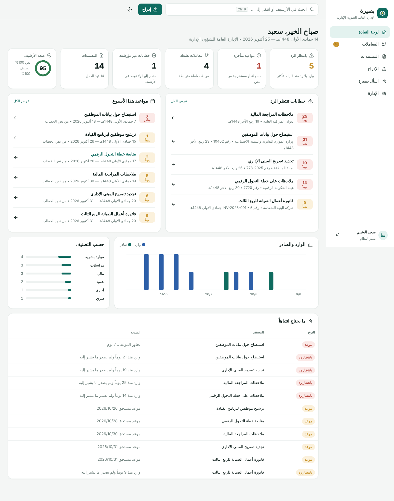
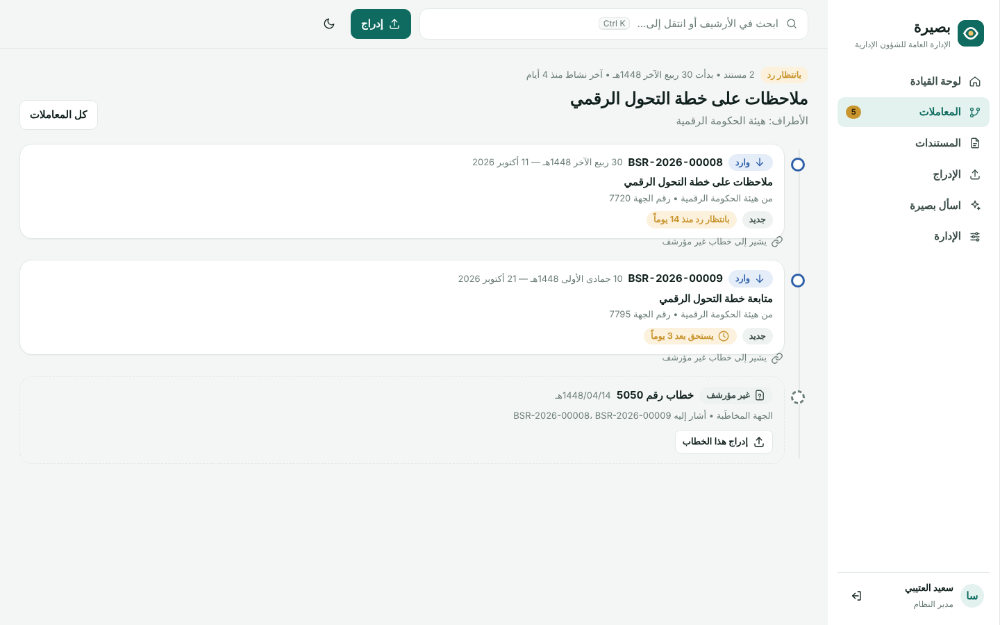
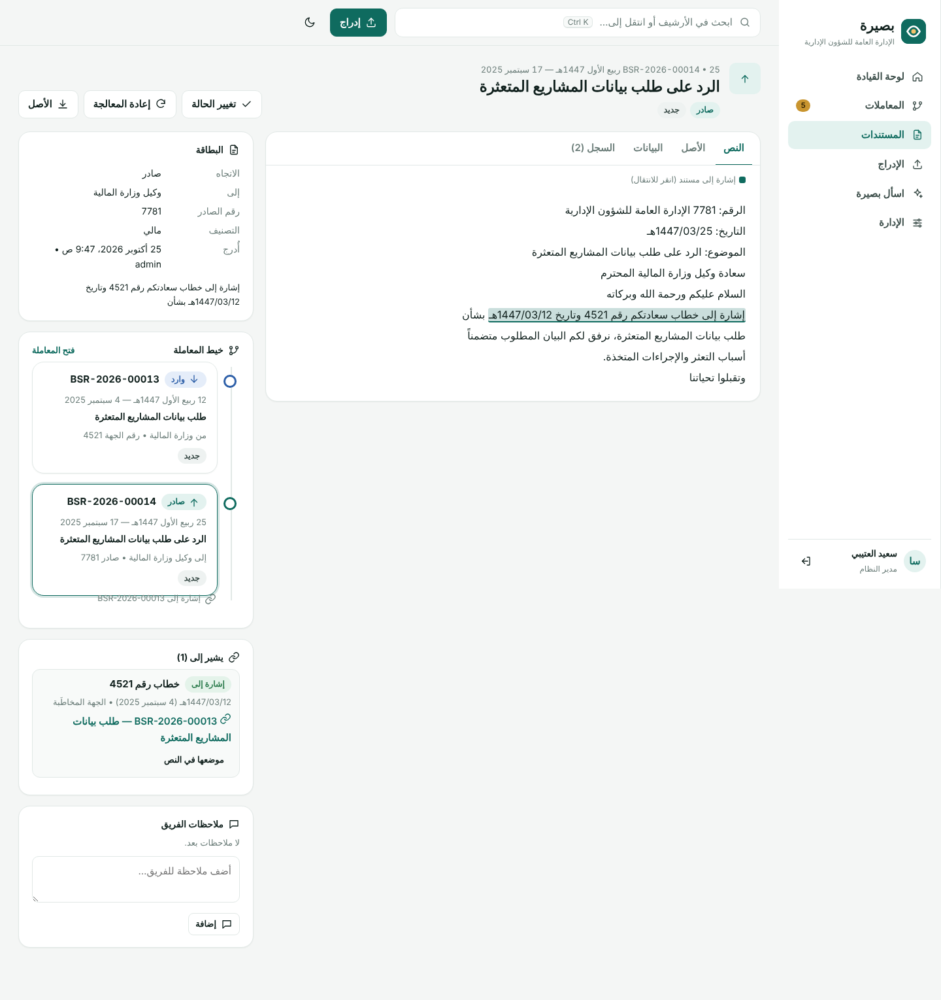
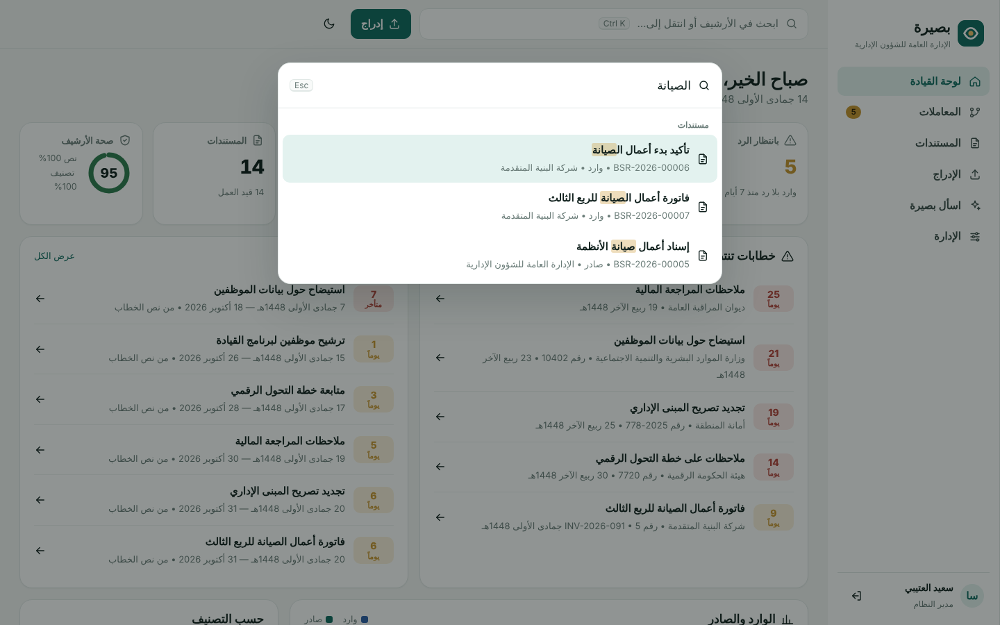
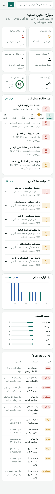

# بصيرة 3 — منصة الأرشفة الذكية

منصة أرشفة عربية تفهم **المعاملة** لا الملف فقط. تقرأ الخطابات وتستخرج منها:
- **الحقول:** الرقم والتاريخ والموضوع والجهة.
- **الإشارات** إلى الخطابات السابقة.
- **المهل.**

وتربط الخطابات تلقائياً في خيوط زمنية، وتنبّه بكل وارد لم يصدر ما يشير إليه.



## ما يميّزها

| القدرة | ما تفعله |
|---|---|
| **المعاملات** | كل خطاب يذكر «إشارة إلى خطابكم رقم … وتاريخ …» أو «رداً على» أو «إلحاقاً لـ» يُربط بالخطاب المقصود. وتُعرض السلسلة في خط زمني بالهجري والميلادي |
| **الخطابات الغائبة** | الخطاب المشار إليه وغير الموجود في الأرشيف يظهر عقدة في المعاملة، فتعرف ما ينقص أرشيفك |
| **بانتظار الرد** | كل وارد لم يصدر ما يشير إليه خلال المهلة يظهر في لوحة القيادة بعدد أيام الانتظار |
| **المهل من النص** | «خلال (15) يوماً من تاريخه»، «خلال عشرة أيام عمل»، «في موعد أقصاه 1448/5/1هـ» تصبح مواعيد محسوبة، وتسقط عند الرد |
| **قراءة الترويسة** | الرقم والتاريخ والموضوع والجهة المرسلة والمخاطَب تُملأ تلقائياً من نص الخطاب |
| **إدراج متعدد المصادر** | سحب وإفلات، وكاميرا الجهاز، ومجلد يراقبه السكانر. ويُرفض المكرر ببصمة المحتوى |
| **قراءة كل الصيغ** | PDF نصي (مع تصحيح العربية المعكوسة)، وPDF مصوّر، وصور عبر Tesseract، وWord، ونص |
| **بحث فوري** | Ctrl+K من أي صفحة. يتجاهل التشكيل والهمزات ويفهم صيغ الجمع، ومعه «اسأل بصيرة» بأدلة مرقّمة |
| **حوكمة** | أدوار وصلاحيات، وحجب المحتوى الحساس، ونسخة كاملة لكل تعديل، ومنع الكتابة فوق تعديل زميل، وسجل تدقيق بسلسلة تجزئة يكشف التلاعب |
| **محلية بالكامل** | لا يُرسل أي مستند إلى خدمة خارجية |

| المعاملة | المستند وإشاراته |
|---|---|
|  |  |
| **البحث السريع** | **الهاتف** |
|  |  |

## التشغيل

**Windows (جهاز واحد):** شغّل `Basira.exe` من الحزمة. لا يحتاج تثبيت .NET، ويفتح المتصفح تلقائياً، ويطلب في أول تشغيل إنشاء حساب المدير. التفاصيل في `tools/platform-readme-ar.txt`.

**خادم لعدة مستخدمين:** `Basira.exe --urls http://0.0.0.0:8080 --no-browser` خلف وكيل HTTPS، أو `docker build -t basira .`، وصورة Docker تحوي Tesseract وPoppler.

**ترحيل النسخة السابقة:** من الإدارة ← «ترحيل النسخة السابقة»، أو `Basira.exe --import-legacy "%AppData%\SaeedAIDocArchive"`.

## البناء والاختبار

| الأمر | الغرض |
|---|---|
| `tools/build-platform-package.sh` | حزمة Windows: ملف تنفيذي واحد مستقل |
| `dotnet run --project src/Basira.Platform` | تشغيل المنصة للتطوير |
| `dotnet test tests/Basira.Platform.Tests` | اختبارات التكامل للمنصة كاملة، ومنها OCR وPDF حقيقيان |
| `dotnet run --project Tests -c Release` | فحوص النواة: المحرك، ومجموعات الإشارات، والمهل، وسلسلة التدقيق |
| `node tools/sample/seed.mjs <url> tests/Basira.Platform.Tests/Fixtures` | أرشيف تجريبي واقعي لبيئات التطوير |

## البنية

```
AIDocumentArchiveVB/Services   نواة VB.NET المشتركة: محرك البحث، ومحلل الإشارات، والمهل، وسلسلة التدقيق، وكلمات المرور
src/Basira.Core                تجميع النواة كمكتبة .NET 8
src/Basira.Platform            المنصة: ASP.NET Core + SQLite + طابور المعالجة + الواجهة المضمّنة (wwwroot)
tests/Basira.Platform.Tests    اختبارات تكامل بخادم كامل
Tests/                         فحوص النواة ومجموعات قياس محلل الإشارات (Corpus)
AIDocumentArchiveVB/           التطبيق المكتبي السابق (WinForms)، باقٍ للمرجعية ومصدراً للترحيل
```

## الوثائق

| الملف | المحتوى |
|---|---|
| `docs/PLATFORM_AR.md` | المنصة: المعمارية، والأمان، والتشغيل، والتحقق وحدوده |
| `docs/REFERENCE_PARSER_AR.md` | محلل الإشارات: منهجية القياس ونتائجه، والمعايرة على خطاباتكم |
| `docs/PERFORMANCE_REPORT_AR.md` | قياسات أداء محرك البحث |
| `docs/EXECUTION_REPORT_AR.md` | سجل مراحل العمل |
| `docs/ANALYSIS_REPORT_AR.md` | تحليل النسخة السابقة |
