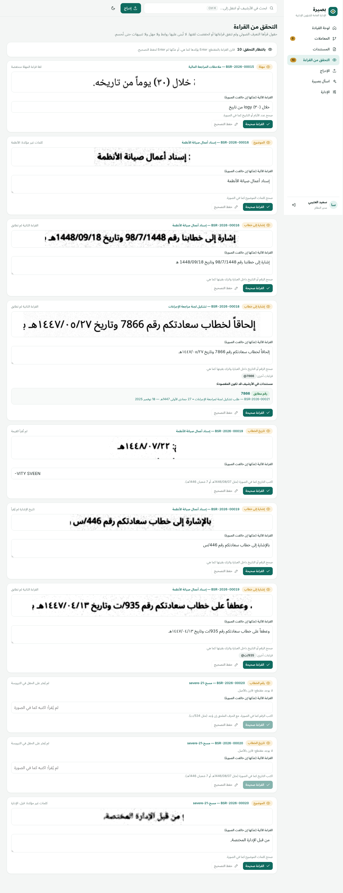
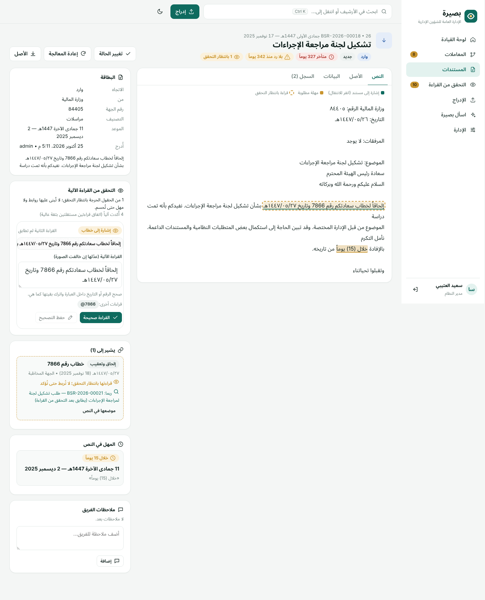

# بصيرة 3 — منصة الأرشفة الذكية

منصة أرشفة عربية تفهم **المعاملة** لا الملف فقط. تقرأ الخطابات وتستخرج منها:
- **الحقول:** الرقم والتاريخ والموضوع والجهة.
- **الإشارات** إلى الخطابات السابقة.
- **المهل.**

وتربط الخطابات تلقائياً في خيوط زمنية، وتنبّه بكل وارد لم يصدر ما يشير إليه.


## ما يميّزها

| القدرة | ما تفعله |
|---|---|
| **المعاملات** | كل خطاب يذكر «إشارة إلى خطابكم رقم … وتاريخ …» أو «رداً على» أو «إلحاقاً لـ» يُربط بالخطاب المقصود. وتُعرض السلسلة في خط زمني بالهجري والميلادي |
| **الخطابات الغائبة** | الخطاب المشار إليه وغير الموجود في الأرشيف يظهر عقدة في المعاملة، فتعرف ما ينقص أرشيفك |
| **بانتظار الرد** | كل وارد لم يصدر ما يشير إليه خلال المهلة يظهر في لوحة القيادة بعدد أيام الانتظار |
| **المهل من النص** | «خلال (15) يوماً من تاريخه»، «خلال عشرة أيام عمل»، «في موعد أقصاه 1448/5/1هـ» تصبح مواعيد محسوبة، وتسقط عند الرد |
| **عنوان وتصنيف تلقائيان** | كل مستند يُدرج يأخذ عنواناً من محتواه وتصنيفاً عاماً وفرعياً مع درجة ثقة وسبب. التصنيف غير الواثق يُعرض «مقترحاً» يؤكَّد بضغطة، وتتعلم المنصة من تأكيداتكم وتعرض دقتها الفعلية |
| **استوديو الرد** | من أي خطاب وارد: ما يطلبه بنداً بنداً، وسطر الإشارة جاهزاً برقمه وتاريخه الهجري، ونوع الرد، و**ردودكم السابقة على خطابات مشابهة** مهيأة له. معاينة وطباعة، ثم حفظ مسودة للاعتماد أو إصدار يربط الرد بالمعاملة ويُسقط «بانتظار الرد». كل رد يصبح سابقة لما يشبهه |
| **سجل الالتزامات** | ما وعدنا به في صادرنا («وسنوافيكم بالبيان خلال عشرة أيام») وما وُعدنا به في واردهم («وسيتم تزويدكم بالقرار»)، يُرصد تلقائياً من النصوص بموعده، ويُرجَّح الوفاء به بخطاب لاحق في المعاملة، وينبّه إلى المتأخر، مع خطاب تعقيب أو وفاء جاهز من استوديو الرد |
| **فهم المعنى محلياً** | نموذج تمثيل دلالي (ONNX) يوضع في `models\semantic` بجوار البرنامج أو يُنزَّل من الإدارة، فيصنّف الخطاب بمعناه لا بكلماته فقط. يعمل على الجهاز نفسه، ويُعاير تلقائياً على عينات مصنفة، ويعرض دقته مقارنة بالقواعد |
| **قراءة الترويسة** | الرقم والتاريخ والموضوع والجهة المرسلة والمخاطَب تُملأ تلقائياً من نص الخطاب |
| **إدراج متعدد المصادر** | سحب وإفلات، وكاميرا الجهاز، ومجلد يراقبه السكانر. ويُرفض المكرر ببصمة المحتوى |
| **قراءة كل الصيغ** | PDF نصي (مع تصحيح العربية المعكوسة)، وPDF مصوّر، وصور عبر Tesseract، وWord، ونص |
| **قراءة يُوثق بها** | فحص جودة المسح، وتحسين الصورة، ونماذج دقيقة، وقارئ مخصص للأرقام الهندية. كل رقم وتاريخ وإشارة لم تتفق عليه قراءتان مستقلتان يُعرض للتحقق بمقتطع من الصورة، ولا تُبنى عليه روابط ولا مهل حتى يُحسم |
| **بحث فوري** | Ctrl+K من أي صفحة. يتجاهل التشكيل والهمزات ويفهم صيغ الجمع، ومعه «اسأل بصيرة» بأدلة مرقّمة |
| **حوكمة** | أدوار وصلاحيات، وحجب المحتوى الحساس، ونسخة كاملة لكل تعديل، ومنع الكتابة فوق تعديل زميل، وسجل تدقيق بسلسلة تجزئة يكشف التلاعب |
| **محلية بالكامل** | لا يُرسل أي مستند إلى خدمة خارجية |

| المعاملة | المستند وإشاراته |
|---|---|
|  |  |
| **التحقق من القراءة** | **المستند وحقوله المعلقة** |
|  |  |
| **البحث السريع** | **الهاتف** |
|  |  |

## التشغيل

**Windows (جهاز واحد):** شغّل `Basira.exe` من الحزمة. لا يحتاج تثبيت .NET، ويفتح المتصفح تلقائياً، ويطلب في أول تشغيل إنشاء حساب المدير. التفاصيل في `tools/platform-readme-ar.txt`.

**خادم لعدة مستخدمين:** `Basira.exe --urls http://0.0.0.0:8080 --no-browser` خلف وكيل HTTPS، أو `docker build -t basira .`، وصورة Docker تحوي Tesseract وPoppler.

**ترحيل النسخة السابقة:** من الإدارة ← «ترحيل النسخة السابقة»، أو `Basira.exe --import-legacy "%AppData%\SaeedAIDocArchive"`.

## البناء والاختبار

| الأمر | الغرض |
|---|---|
| `tools/build-platform-package.sh` | حزمة Windows: ملف تنفيذي واحد مستقل |
| `dotnet run --project src/Basira.Platform` | تشغيل المنصة للتطوير |
| `dotnet test tests/Basira.Platform.Tests` | اختبارات التكامل للمنصة كاملة، ومنها OCR وPDF حقيقيان |
| `dotnet run --project Tests -c Release` | فحوص النواة: المحرك، ومجموعات الإشارات، والمهل، وسلسلة التدقيق |
| `tools/fetch-tessdata.sh` | جلب نماذج OCR الدقيقة (تُرفق بالحزمة؛ لا تُحفظ في المستودع) |
| `dotnet run --project tools/OcrBench -c Release -- <مجلد> pipeline` | قياس دقة OCR على صور بقيم صحيحة معروفة (`docs/OCR_ACCURACY_AR.md`) |
| `node tools/sample/seed.mjs <url> tests/Basira.Platform.Tests/Fixtures` | أرشيف تجريبي واقعي لبيئات التطوير |

## البنية

```
AIDocumentArchiveVB/Services   نواة VB.NET المشتركة: محرك البحث، ومحلل الإشارات، والمهل، وسلسلة التدقيق، وكلمات المرور
src/Basira.Core                تجميع النواة كمكتبة .NET 8
src/Basira.Platform            المنصة: ASP.NET Core + SQLite + طابور المعالجة + الواجهة المضمّنة (wwwroot)
src/Basira.Platform/Processing/Ocr   خط القراءة: بوابة الجودة، وتحسين الصورة، وقارئ الأرقام، والتحقق من الحقول
tools/OcrBench, tools/ocr-bench      قياس دقة OCR ومولّد خطابات الاختبار وتشويه المسح
tools/DigitTemplates           توليد قوالب قارئ الأرقام من خطوط مفتوحة
tests/Basira.Platform.Tests    اختبارات تكامل بخادم كامل
Tests/                         فحوص النواة ومجموعات قياس محلل الإشارات (Corpus)
AIDocumentArchiveVB/           التطبيق المكتبي السابق (WinForms)، باقٍ للمرجعية ومصدراً للترحيل
```

## الوثائق

| الملف | المحتوى |
|---|---|
| `docs/PLATFORM_AR.md` | المنصة: المعمارية، والأمان، والتشغيل، والتحقق وحدوده |
| `docs/REFERENCE_PARSER_AR.md` | محلل الإشارات: منهجية القياس ونتائجه، والمعايرة على خطاباتكم |
| `docs/COMMITMENTS_AR.md` | سجل الالتزامات: الرصد، والموعد، والوفاء، والقياس |
| `docs/REPLY_STUDIO_AR.md` | استوديو الرد: الطلبات، والإشارة، والسوابق، والمسودة والاعتماد والإصدار |
| `docs/CLASSIFICATION_AR.md` | التصنيف الآلي والعنوان من المحتوى: الطريقة، والقياس بصراحة، والتعلم من الأرشيف |
| `docs/OCR_ACCURACY_AR.md` | دقة قراءة الصور: الطبقات الخمس، والقياس قبل وبعد، والتحقق البشري، والقياس على خطاباتكم |
| `docs/PERFORMANCE_REPORT_AR.md` | قياسات أداء محرك البحث |
| `docs/EXECUTION_REPORT_AR.md` | سجل مراحل العمل |
| `docs/ANALYSIS_REPORT_AR.md` | تحليل النسخة السابقة |
