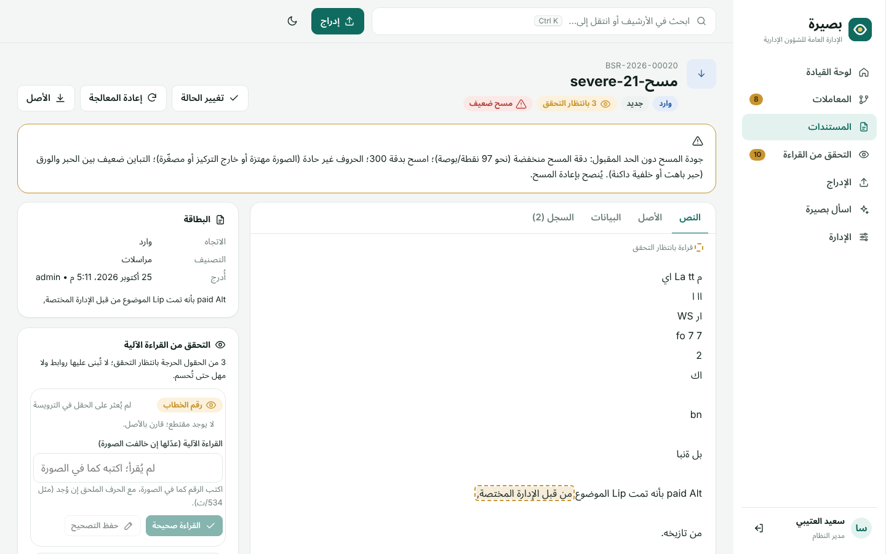

# دقة قراءة الصور والمسح الضوئي (OCR)

## المشكلة والهدف

قرارات المنصة تقوم على حقول تقرؤها من الخطاب:
- **رقم الخطاب** يحدد هويته، فتُربط به الردود.
- **تاريخه** تُحسب منه المهل ومدة الانتظار.
- **الإشارات** تبني المعاملات وتكشف الخطابات الغائبة.

الخطأ في أي منها لا يبقى خطأ قراءة، بل يصير قراراً خاطئاً: رد يُربط بغير أصله، أو مهلة تُحسب من تاريخ خاطئ، أو خطاب سليم يُعلن غائباً.

الهدف ليس قراءة كل حرف بلا خطأ، فهذا لا يضمنه أي محرك OCR. الهدف ألا **تُبنى قرارات على قراءة خاطئة دون علم أحد**. لذلك المقياس الأول في هذا التقرير هو **«الخطأ الصامت»**: قيمة خاطئة لم تُعلَّم للمراجعة.

## الحل: خمس طبقات

| الطبقة | ما تفعله | الشيفرة |
|---|---|---|
| **1. بوابة الجودة** | تقيس كل صورة قبل قراءتها: الدقة الفعلية (من حجم الحروف بالبكسل)، وحدة الحواف، والتباين بين الحبر والورق، والتشويش، والميلان. الصورة دون الحد تُعلَّم «مسح ضعيف» مع السبب المحدد وتوصية بإعادة المسح، ولا يُعتمد منها أي حقل آلياً | `Processing/Ocr/ImagePrep.cs` |
| **2. تحسين الصورة والنموذج الدقيق** | تسوية الإضاءة بقسمة الصورة على خلفية محلية مقدّرة، وإزالة التشويش، ومد التباين، وتصحيح الميلان، والتكبير إلى ما يعادل 300 نقطة/بوصة. ثم القراءة بنماذج Tesseract الدقيقة (tessdata_best) المرفقة بالمنصة | `ImagePrep.cs`، `TesseractOcr.cs` |
| **3. التحقق المستقل** | ثقة لكل كلمة، و**قارئ أرقام مخصص** (انظر أدناه)، وقراءة ثانية مستقلة لكل حقل حرج. يُعتمد الحقل آلياً إذا اتفق عليه مصدران مستقلان بثقة عالية. وإذا اختلفت القراءتان، أو تناقضت قراءة الحقل كاملاً مع قيمته، يُعرض على المراجع | `NumberRepair.cs`، `DigitReader.cs`، `OcrPipeline.cs` |
| **4. التحقق من الأرشيف** (أساسي) | الإشارة التي لا تطابق أي مستند لكنها تختلف بحرف واحد عن رقم في الأرشيف، أو تطابق رقماً لم يُؤكد بعد، تظهر **اقتراحاً** لا «خطاباً غائباً» | `Intelligence/ArchiveIndex.cs`، `Api/ReviewApi.cs` |
| **5. طابور التحقق وتعليق القرارات** | كل حقل غير مؤكد يظهر في صفحة «التحقق من القراءة» بمقتطع من الصورة، فيؤكده المراجع بضغطة أو يصححه. ولا تُبنى عليه قرارات قبل ذلك: الإشارة المعلقة لا تربط ولا تنشئ خطاباً غائباً، والتاريخ المعلق لا تُحسب منه مهلة، والرقم المعلق لا يُعتمد هوية للمستند | `Data/ReviewStore.cs`، `Api/ReviewApi.cs`، `wwwroot/review.js` |

### قارئ الأرقام المخصص

أكبر مصدر للخطأ في القياس كان **الأرقام الهندية** (٠١٢٣٤٥٦٧٨٩)، الشائعة في المراسلات الرسمية: نماذج Tesseract العربية، حتى الدقيقة منها، تقرأ «٢٢٠٥٢» حروفاً لاتينية «YY OY». بُني لذلك قارئ مستقل يعمل كالتالي:
- يقطّع منطقة الرقم إلى مكوناتها المتصلة، ويفصل الرقمين الملتصقين عند أقل عمود حبراً.
- يصنّف كل مكون بأقرب نموذج من نحو 14,600 قالب مولّدة من 24 خطاً عربياً مفتوح الرخصة (OFL)، بأحجام وتشويهات متعددة.
- يقرر الخط للرقم كاملاً، هندياً أو عربياً، فلا يُخلط «٥» الهندي بـ«0» العربي.
- يميز الصفر الهندي من النقطة بموضعه في السطر.
- ثقته هي هامش الفرق بين أقرب صنف وأقرب صنف بقيمة مختلفة.

ويعمل القارئ بطريقتين: يصلح قراءة Tesseract إذا قرأت الأرقام حروفاً، ويكون مصدراً مستقلاً ثانياً للتحقق من الأرقام العربية.

**ضوابط تمنع اختلاق الأرقام:**
- لا يستبدل كلمة فيها حروف عربية (مثل «534/ت»)، بل يتحقق من جزئها الرقمي فقط.
- لا يستبدل كلمة بلا أرقام إلا إذا سبقتها كلمة سياق: «رقم» أو «وتاريخ» أو «خلال».
- لا يكتب قراءة غير واثقة في النص إلا مقترحاً معلَّماً للمراجعة.
- إذا غطى الرمز المقروء جزءاً من الكلمة فقط، تُعلَّم الكلمة للمراجعة ولا تُستبدل.
- إذا لامس الرمز حافة المنطقة، تُوسَّع المنطقة وتُعاد القراءة، فلا يُعتمد رقم مقطوع.

**تصحيحات أخطاء OCR العربي المتكررة، وكلها مقيدة بشروط صارمة:**
- «هـ» الملاصقة للتاريخ تُقرأ «2» في أوله: «21446/08/07» تصبح «1446/08/07هـ».
- الشرطة المائلة تُقرأ ألفاً: «534/ات» تصبح «534/ت».
- ترتيب الكلمات في السطر المختلط يُعاد بحسب موضعها في الصورة.

## منهجية القياس

لا تتوفر بعد عيّنة من مراسلاتكم الحقيقية، فبُني قياس قابل للتكرار:

- **الخطابات:** 40 خطاباً عربياً يولّدها `tools/ocr-bench/make-corpus.mjs`، بقيم صحيحة معروفة:
  - **الترويسة:** الرقم (عددي، أو بحرف ملحق مثل 534/ت، أو بصيغة 26/2/1447).
  - **التاريخ:** هجري رقمي، أو بأرقام هندية، أو باسم الشهر.
  - **المتن:** إشارات إلى خطابات سابقة بأرقامها وتواريخها، ومهلة «خلال (N) يوماً».
  - **الخطوط:** Noto Naskh Arabic وNoto Sans Arabic وDejaVu Sans.
  - **التصوير:** تُصوَّر بدقة 300 نقطة/بوصة.
- **التشويه:** `degrade.py` يحاكي عيوب المسح بأربعة مستويات:

  | المستوى | الميلان | التصغير | التمويه | ضغط JPEG | التشويش | التباين | الظل |
  |---|---|---|---|---|---|---|---|
  | نظيف | 0° | 1.0 | 0 | 92 | 0 | 100% | 0 |
  | خفيف | 1.2° | 0.85 | 0.6 | 75 | 5 | 90% | 25 |
  | متوسط | 3° | 0.67 | 1.0 | 50 | 10 | 75% | 45 |
  | شديد | 5.5° | 0.5 | 1.4 | 35 | 16 | 60% | 70 |

  أي 160 صورة لكل مجموعة.
- **الخط الأساسي:** ما كانت تفعله المنصة قبل هذا العمل: Tesseract بنماذجه المثبتة، دون معالجة للصورة.
- **فصل التطوير عن القياس:**
  - طُوّرت الطبقات وضُبطت على مجموعة تطوير (البذرة 20261025).
  - النتائج الرئيسية أدناه على **مجموعة جديدة لم تُفتح أثناء التطوير** (البذرة 52219)، قيست مرة واحدة بعد تجميد الشيفرة، دون أي تعديل بعدها.
  - مجموعة ثالثة (البذرة 91731) استُبعدت من القياس، لأن خمساً من صورها استُخدمت في لقطات الواجهة، وكشفت إحداها خطأً عاماً أُصلح.
- **فصل الخطوط:** قوالب قارئ الأرقام مولّدة من 24 خطاً ليس بينها أي خط من خطوط القياس الثلاثة.

## النتائج على المجموعة المستقلة

**القراءة الصحيحة / الخطأ الصامت** (قيمة خاطئة لم تُعلَّم). وفي عمود «بعد» تُذكر أيضاً نسبة ما عُرض للتحقق.

| الحقل | المستوى | قبل: صحيح | قبل: خطأ صامت | بعد: صحيح | بعد: خطأ صامت | بعد: للتحقق |
|---|---|---|---|---|---|---|
| رقم الخطاب | نظيف | 77.5% | 17.5% | **97.5%** | **0%** | 25% |
| | خفيف | 77.5% | 17.5% | **100%** | **0%** | 12.5% |
| | متوسط | 55% | 12.5% | **90%** | **0%** | 42.5% |
| تاريخ الخطاب | نظيف | 67.5% | 0% | **90%** | **0%** | 25% |
| | خفيف | 70% | 2.5% | **92.5%** | **0%** | 17.5% |
| | متوسط | 45% | 2.5% | **77.5%** | **0%** | 55% |
| الإشارات (رقم + تاريخ) | نظيف | 73% | 24.3% | **86.5%** | **0%** | 18.9% |
| | خفيف | 35.1% | 54.1% | **91.9%** | **0%** | 18.9% |
| | متوسط | 8.1% | 5.4% | **73%** | **0%** | 48.6% |
| الموضوع | نظيف | 97.5% | 0% | 97.5% | 0% | 5% |
| | متوسط | 7.5% | 0% | **95%** | **0%** | 15% |
| المهلة | نظيف | 91.3% | 0% | **95.7%** | 0% | 8.7% |
| | متوسط | 21.7% | 0% | **95.7%** | 0% | 0% |

**المستوى الشديد:** رفضت بوابة الجودة الصور الأربعين كلها، ولم ترفض أي صورة من المستويات الأخرى. أسباب الرفض: الحروف غير حادة (40)، والتباين ضعيف (40)، والدقة منخفضة (25). ولم يُعتمد من هذه الصور أي حقل آلياً، فالخطأ الصامت فيها **0%**.

**النتيجة الجوهرية: الخطأ الصامت 0.0% في كل الحقول وكل المستويات (160 صورة).** كل قراءة خاطئة عُلِّمت للتحقق قبل أن تُبنى عليها روابط أو مهل. وقبل هذا العمل كانت المنصة تعتمد بصمت رقم ترويسة خاطئاً في 13% من الصور، وإشارة خاطئة في 21% من الإشارات.

### أثر كل طبقة (المستويات الأربعة مجتمعة، المجموعة المستقلة)

| الإعداد | الرقم: صحيح / صامت | التاريخ | الإشارات | المهلة | زمن الصفحة على نواة |
|---|---|---|---|---|---|
| الخط الأساسي | 52.5% / 13.1% | 45.6% / 1.3% | 29.1% / 20.9% | 51.1% / 0% | 0.8 ث |
| + النموذج الدقيق | 55% / 9.4% | 45.6% / 0.6% | 27% / 20.9% | 53.3% / 0% | 1.7 ث |
| + تحسين الصورة | 67.5% / 10% | 58.1% / 0.6% | 57.4% / 18.9% | 78.3% / 0% | 3.1 ث |
| + قارئ الأرقام | 75.6% / 3.1% | 66.3% / 0% | 64.2% / 12.2% | 78.3% / 0% | 3.6 ث |
| + التحقق والتعليق (الكامل) | **76.9% / 0%** | **68.1% / 0%** | **64.2% / 0%** | **78.3% / 0%** | 4.5 ث |

تشمل هذه الأرقام المستوى الشديد، وأغلب حقوله «مفقودة» لأن البوابة ترفضه.

قراءة الجدول:
- **تحسين الصورة** أكبر أثر في المستويين الخفيف والمتوسط: الإشارات من 27% إلى 57%، والمهل من 53% إلى 78%.
- **قارئ الأرقام** أكبر أثر في الأرقام والتواريخ الهندية.
- **التحقق** لا يرفع نسبة الصحيح كثيراً، لكنه يحوّل كل خطأ متبقٍ من صامت إلى معلَّم.

### على مجموعة التطوير (للمقارنة)

النتيجة متسقة مع المجموعة المستقلة:
- **الخطأ الصامت:** 0% في كل الحقول والمستويات.
- **الصور النظيفة:** الرقم 100%، والتاريخ 97.5%، والموضوع 100%، والإشارات 88.6%، والمهلة 100%.

المخرجات الكاملة لكل الإعدادات والمستويات في `docs/ocr-benchmark-results.txt`.

## ماذا تعني «نسبة التحقق»

ما يُعرض للتحقق ليس كله خطأ؛ أغلبه قراءات صحيحة لم تبلغ حد الاطمئنان. ومراجعتها سريعة: نظرة إلى المقتطع، ثم Enter للتأكيد.

على الصور النظيفة يُعرض نحو ربع الأرقام والتواريخ:
- **الأرقام (10 حالات):** في 7 منها السبب الحرف الملحق بالرقم («551/س»). قارئ الأرقام لا يقرأ الحروف، فلا يُعتمد الحرف إلا إذا اتفقت عليه قراءتان من Tesseract أو كانت ثقته عالية.
- **التواريخ (10 حالات):** ثقة منخفضة في 5، وتعذّر القراءة في 2، وتعذّر العثور على الحقل في الترويسة في 3.

هذا الحد اختيار مقصود: **الأمان أولاً ثم تقليل المراجعة**. ويمكن خفض النسبة بعد قياس عيّنة حقيقية، إن أثبتت أن القراءات فوق حد معين صحيحة دائماً.

## المحرك المرئي (3.6)

يمكن الآن قراءة النص بنموذج رؤية لغوي يعمل محلياً، مع بقاء خط Tesseract هذا قراءةً ثانية تتحقق من الحقول الحرجة. التفاصيل في `OCR_ENGINES_AR.md`.

## الحدود (بصراحة)

- **الخطابات اصطناعية.** صُوّرت من HTML ثم شُوّهت بمحاكاة. والمسح الحقيقي فيه ما لا تحاكيه: الأختام والتواقيع فوق النص، والخط اليدوي، والجداول، والطيات، والأوراق الملونة، والكتابة بخطوط تجارية غير موجودة في القياس.
- **المجموعة المستقلة من المولّد نفسه.** القيم والخطوط والتشويه جديدة، لكن صيغ الخطابات وعباراتها من القوالب نفسها. فالقياس يثبت أن النتيجة لا تعتمد على عيّنات بعينها، ولا يثبت أنها تعمّ صيغ جهتكم.
- **الصفر الصامت مقيس على 160 صورة.** هذا لا يعني استحالة الخطأ الصامت؛ فقد يقع حين تخطئ قراءتان مستقلتان الخطأ نفسه بثقة عالية. والعيّنة الحقيقية الكبيرة هي التي تقدّر احتماله.
- **الطبقة الرابعة جزئية.** الاقتراحات من الأرشيف تعمل، لكن التحقق المتقاطع الكامل يحتاج عيّنات حقيقية وأرشيفاً فعلياً. ومن أمثلته: هل يتسق تاريخ الرد مع تاريخ الأصل؟ وهل الجهة المرسلة هي المخاطَبة في الأصل؟
- **قارئ الأرقام مدرَّب على أرقام مطبوعة.** الأرقام المكتوبة باليد لا يقرؤها بثقة، فتُعرض للتحقق.
- **ملفات TIFF** تُقرأ بـ Tesseract مباشرة دون تحسين الصورة ولا قارئ الأرقام، فمكتبة الصور المستخدمة لا تفتحها. والمستحسن ضبط السكانر على PDF أو PNG أو JPEG.
- **الزمن:** نحو 4.5 ثوانٍ للصفحة على نواة واحدة، مقابل 0.8 ثانية قبل ذلك. وتعالج المنصة عدة مستندات بالتوازي.


## الاستخدام اليومي

- **الإدراج كما هو:** تُدرج الصور وملفات PDF المصورة كالمعتاد. عند اكتمال المعالجة تظهر رسالة «N من الحقول الحرجة بانتظار التحقق» إن وُجدت.
- **صفحة «التحقق من القراءة»** (للأدوار التي تملك صلاحية التعديل) تعرض كل حقل معلق بمقتطعه من الصورة وسبب الشك. إن كانت القراءة مطابقة للصورة فاضغط Enter لتأكيدها. وإن خالفتها فعدّلها ثم اضغط Enter لحفظ التصحيح. يُصحح النص في موضعه، ويُحدَّث الحقل المرتبط (الرقم أو التاريخ أو العنوان)، ويُسجَّل القرار في سجل التدقيق ونسخ المستند.
- **صفحة المستند** تعرض لوحة «التحقق من القراءة الآلية» ببطاقات الحقول المعلقة، وتُميز الحقول غير المؤكدة في النص بإطار متقطع. وتظهر الإشارة المعلقة بعبارة «قراءتها بانتظار التحقق؛ لا تُربط حتى تُؤكد» مع اقتراح المستند المحتمل.
- **«مسح ضعيف»** يظهر على المستند مع السبب المحدد. الأفضل إعادة مسحه بدقة 300 نقطة/بوصة ثم إدراجه من جديد.


| المستند وحقوله المعلقة | مسح ضعيف |
|---|---|
|  |  |

## القياس على خطاباتكم الحقيقية

نتائج هذا التقرير على خطابات اصطناعية. **الرقم الذي يعتد به هو القياس على عيّنة من مراسلاتكم**، ويكفي 50 إلى 100 خطاب ممسوح بأجهزة المسح المستخدمة فعلاً، مع حجب البيانات الحساسة:

1. ضع الصور في مجلد **خارج المستودع**، وأضف ملف `truth.json` بالقيم الصحيحة لكل صورة:
   ```json
   [{ "file": "001.jpg", "level": "سكانر الإدارة", "number": "4521", "date": "H1447-03-12",
      "subject": "طلب بيانات المشاريع المتعثرة", "refs": [{ "number": "4510", "date": "H1447-02-28" }], "deadlineDays": 15 }]
   ```
   حقل `level` تصنيف حر تُجمع النتائج بحسبه، مثل نوع السكانر أو الإدارة. والتاريخ يُكتب بالصيغة `H` أو `G` ثم سنة-شهر-يوم.
2. اجلب النماذج: `tools/fetch-tessdata.sh`.
3. شغّل: `dotnet run --project tools/OcrBench -c Release -- <المجلد> pipeline 1000 --details`

   يطبع الصحيح والخاطئ والمفقود والخطأ الصامت والمعلَّم لكل حقل، ورفض بوابة الجودة، وتفاصيل كل خطأ.
4. للمقارنة بالخط الأساسي استبدل `pipeline` بـ `baseline`.

وإذا كشفت العيّنة نمطاً لا يغطيه القارئ، كخط أرقام مختلف جذرياً، تُضاف قوالبه:
- ضع خطوط TTF في مجلد.
- شغّل `dotnet run --project tools/DigitTemplates -- <مجلد الخطوط> src/Basira.Platform/Processing/Ocr/digits.bin.gz`.

## إعادة إنتاج القياس

```
tools/fetch-tessdata.sh
node tools/ocr-bench/make-corpus.mjs <مجلد> 40                         # خطابات بقيم صحيحة معروفة (Chromium)
python3 tools/ocr-bench/degrade.py <مجلد> <مجلد-المسح>                  # أربعة مستويات تشويه
dotnet run --project tools/OcrBench -c Release -- <مجلد-المسح> pipeline 1000 --details
```
تولّد بذرة مختلفة (`CORPUS_SEED`) مجموعة جديدة بالقوالب نفسها. ويُستخدم `quality` لطباعة مقاييس الجودة لكل صورة، و`words <صورة> --fields` لعرض كلمات صورة واحدة وثقتها وفحوص حقولها.
